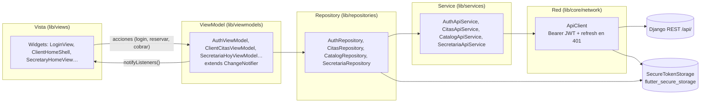

# Arquitectura y patrones de diseño — Stylo Barber Connect Móvil

Criterios 4.2 (MVVM desacoplado) y 4.3 (Singleton, Factory, Repository y Observer) de `MATRIZ_CUMPLIMIENTO.md`. Cada patrón apunta al código real de `develop` y a la prueba que lo ejercita.

## 1. MVVM + Repository

Reglas que se cumplen en el código:

| Regla | Dónde se ve |
|---|---|
| Una vista nunca llama a `ApiClient` ni a un service. | Las vistas solo usan `context.read/watch<…ViewModel>()`; no importan `services/` ni `core/network/`. |
| El ViewModel no conoce widgets ni `BuildContext`. | `lib/viewmodels/*.dart` solo importan `foundation.dart`, modelos y repositorios. |
| El Repository decide de dónde salen los datos y guarda la sesión. | `AuthRepository.completeLogin` guarda tokens en `SecureTokenStorage`; `restoreSession` lee `/auth/me/` y cae al usuario guardado. |
| El Service traduce HTTP ↔ DTO y los errores del backend. | `AuthApiService.login` convierte el JSON de Django en `LoginSuccess` o `LoginRequires2FA`; los `{ok:false}` se vuelven `ApiException`. |

Pruebas que fijan el desacoplamiento: `test/viewmodel_repository_test.dart` (ViewModels con repositorios falsos, sin red) y `test/integration/repositories_http_test.dart` (repository → service → `ApiClient` → JSON con `MockClient`).

## 2. Singleton (composition root)

`AppScope.create()` (`lib/core/di/app_scope.dart`) arma **una sola vez** el grafo de dependencias: un `ApiClient`, un `SecureTokenStorage`, un repositorio por dominio y los ViewModels globales. `main.dart` lo llama una vez y lo comparte con `Provider<AppScope>.value` y `ChangeNotifierProvider.value`, así toda la app usa las mismas instancias.

- Por qué no un `static instance`: la única instancia vive en el árbol de widgets, no en una variable global. Las pruebas montan su propio grafo con dobles (`MockClient`, repositorios falsos) sin tocar estado compartido.
- Instancia única de red y sesión: el refresh de tokens del `ApiClient` y el cierre de sesión (`onSessionExpired` → `AuthViewModel.logout`) operan sobre el mismo almacenamiento.
- Las pantallas de privacidad (y la tienda en el rediseño) crean su ViewModel **por ruta** a propósito: al cambiar de cuenta no queda estado del usuario anterior (PM09).

## 3. Factory

| Fábrica | Qué decide |
|---|---|
| `ServicioDto.fromJson`, `ProductoDto.fromJson`, `ContactoDto.fromJson` (`lib/models/catalog_models.dart`) | Normaliza tipos del backend (números como texto, campos ausentes) y descarta horarios con día inválido. |
| `CitaDto.fromJson`, `BarberoDto.fromJson`, `SlotDisponibilidad.fromJson`, `SecretariaCitaDto.fromJson`, `SecretariaDiaDto.fromJson` (`lib/models/cita_models.dart`) | Arma los DTO de citas, incluida la penalización anidada de secretaría. |
| `AuthUser.fromJson`, `PerfilDto.fromJson` (`lib/models/auth_models.dart`) | Traduce el rol del backend a `UserRole`. |
| `ApiException.fromBody` (`lib/core/errors/app_exception.dart`) | Elige el mensaje correcto entre `error`, `detail`, `mensaje` o texto plano según el sobre de Django. |
| `AuthApiService.login` | Método fábrica: según la respuesta crea un `LoginSuccess` o un `LoginRequires2FA` (clase `sealed LoginResult`). |

Pruebas: `test/contacto_horarios_test.dart` y `test/integration/repositories_http_test.dart` construyen DTO desde JSON con la forma real de Django; la rama de pruebas unitarias agrega fixtures de `fromJson` por modelo.

## 4. Repository

`lib/repositories/*` aíslan a los ViewModels del origen de los datos. `CatalogRepository` es una interfaz (`abstract class`) con su implementación `CatalogRepositoryImpl`, por eso las pruebas la sustituyen sin red (`test/guest_home_premium_test.dart`, `_FixtureCatalogRepository`).

## 5. Observer

Cada ViewModel extiende `ChangeNotifier` y llama a `notifyListeners()` al cambiar de estado (`LoadState.loading → ready/empty/error`, `busy`, `actionMessage`). Las vistas se suscriben con `Consumer<T>` o `context.watch<T>()` y se reconstruyen solas; las acciones usan `context.read<T>()` para no suscribirse.

| Sujeto | Observadores |
|---|---|
| `AuthViewModel` | Splash (decide la ruta inicial), login, 2FA, panel del cliente, secretaría (cerrar sesión). |
| `SecretariaHoyViewModel` | Agenda del día y detalle de cita: tras "Cliente llegó" o un cobro, la agenda se actualiza sin recargar la pantalla. |
| `ClientCitasViewModel` | Inicio (próxima cita) y Mis citas a la vez. |

Pruebas: `test/client_secretary_premium_test.dart` (la búsqueda filtra en vivo la agenda cargada) y `test/secretaria_cobro_dialogo_test.dart` (el cobro actualiza el estado y muestra el mensaje del servidor).

## 6. Flujo de una acción, de punta a punta

"Cobrar restante" en secretaría:

1. `SecretaryCitaDetailView` abre el cobro y llama a `SecretariaHoyViewModel.cobrar(...)`.
2. El ViewModel marca `actionBusy`, notifica (el botón muestra progreso) y llama a `SecretariaRepository.cobrar`.
3. El repositorio delega en `SecretariaApiService`, que hace `POST /secretaria/citas/{id}/cobrar/` con `ApiClient` (Bearer; si responde 401, refresca una vez y reintenta).
4. Django valida y responde; el ViewModel guarda el mensaje, recarga el día y notifica.
5. La agenda y el detalle se redibujan con el estado nuevo: Observer cierra el ciclo.
