# Manual de uso: cliente (Stylo Barber Connect)

Guía paso a paso para reservar, consultar y cuidar tu cuenta en la app de **Tony Stylo Barbería**.

| Dato | Valor |
|---|---|
| Versión de la app en las capturas | **0.8.1+5** (la publicada en Google Play, prueba cerrada Alpha) |
| Dispositivo | Emulador Android "Medium Phone", API 37 (Android 17), 1080 × 2400 |
| Servidor | Backend Django **local de pruebas** (no producción) |
| Fecha de las capturas | 6 de noviembre de 2026 |
| Tarjetas | DE-01, GH#63 (DOC-001) |

Todos los nombres, teléfonos, correos, productos y la dirección que se ven son **datos de prueba** de la base local ("Cliente Prueba", "Barbero Uno Prueba", "Pomada mate (prueba)", "Dirección de prueba (no es real)"). Las capturas son reales; solo se convirtieron a JPG de 720 px de ancho para no inflar el repositorio.

Cuando un paso no tiene captura de la versión 0.8.1, se dice explícitamente y se indica dónde está la evidencia de una versión anterior.

## Contenido

1. [Antes de entrar: la app como invitado](#1-antes-de-entrar-la-app-como-invitado)
2. [Crear tu cuenta](#2-crear-tu-cuenta)
3. [Iniciar sesión](#3-iniciar-sesión)
4. [Tu inicio](#4-tu-inicio)
5. [Reservar una cita en 4 pasos](#5-reservar-una-cita-en-4-pasos)
6. [Mis citas y detalle de una cita](#6-mis-citas-y-detalle-de-una-cita)
7. [Reprogramar o cancelar tu cita](#7-reprogramar-o-cancelar-tu-cita)
8. [Tienda y pedidos](#8-tienda-y-pedidos)
9. [Perfil](#9-perfil)
10. [Privacidad y derechos ARCO](#10-privacidad-y-derechos-arco)
11. [Código por correo al iniciar sesión (2FA opcional)](#11-código-por-correo-al-iniciar-sesión-2fa-opcional)
12. [Cerrar sesión](#12-cerrar-sesión)
13. [Sin conexión](#13-sin-conexión)
14. [Texto grande](#14-texto-grande)

---

## 1. Antes de entrar: la app como invitado

Sin cuenta puedes ver los servicios, los productos, los horarios y el contacto de la barbería. La barra inferior tiene **Inicio, Servicios, Productos, Contacto y Entrar**.

| Paso | Qué ves | Captura |
|---|---|---|
| 1. Abre la app. | Inicio con el lema, si la barbería está abierta ("Abierto ahora, cierra a las 20:00") y el botón **Reservar cita**. Debajo, los servicios con precio y duración. | 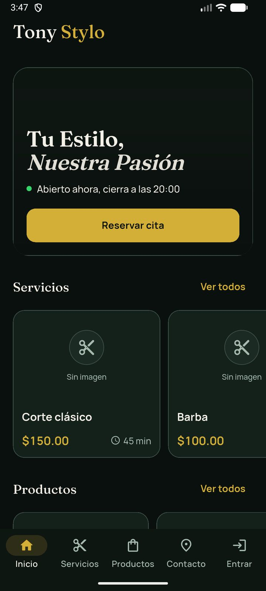 |
| 2. Desliza hacia abajo. | Productos y la tarjeta **Visítanos** con la dirección y el horario. | 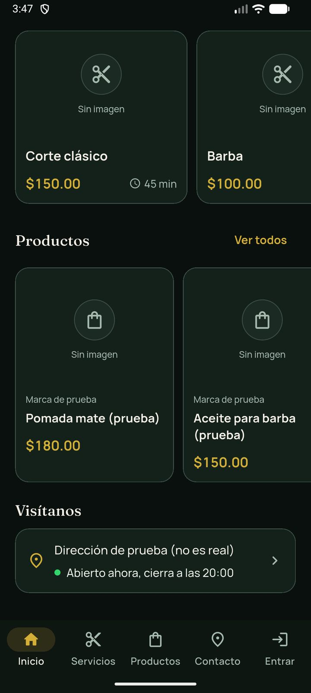 |
| 3. Toca **Servicios**. | Precio y duración de cada servicio. | 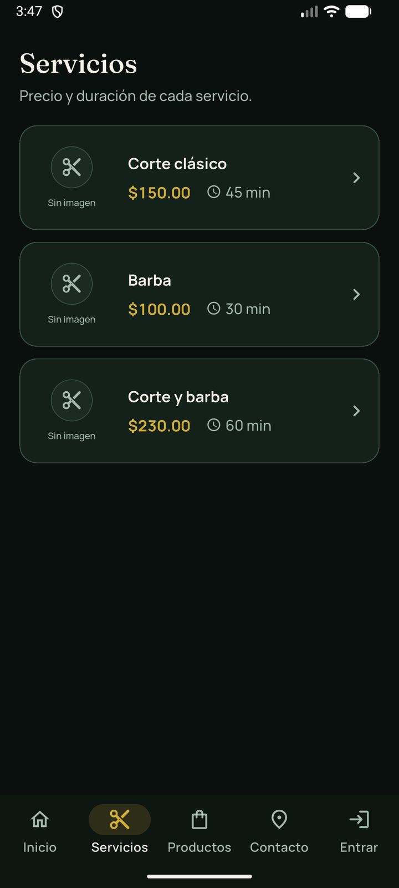 |
| 4. Toca **Productos**. | Productos con marca y precio. | 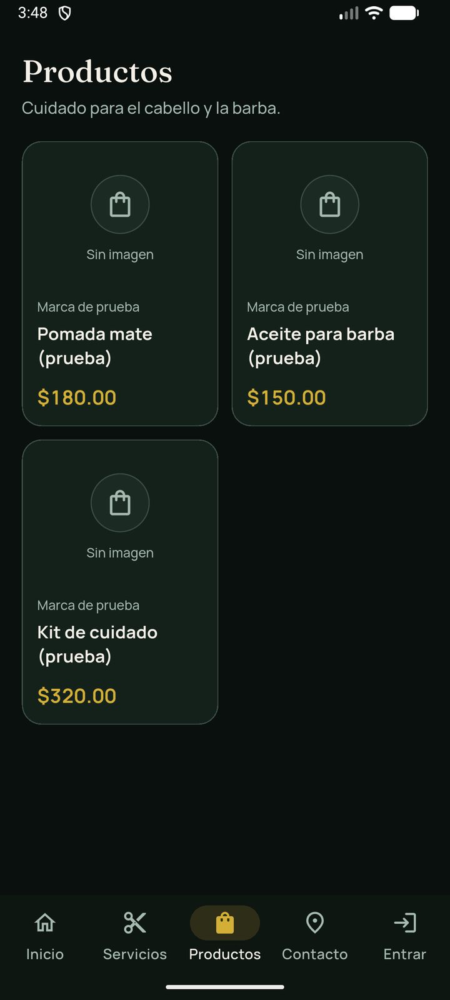 |
| 5. Toca **Contacto**. | Botón **Llamar**, dirección, teléfono y correo (cada uno se puede copiar) y los horarios de la semana, con el día de hoy marcado. | 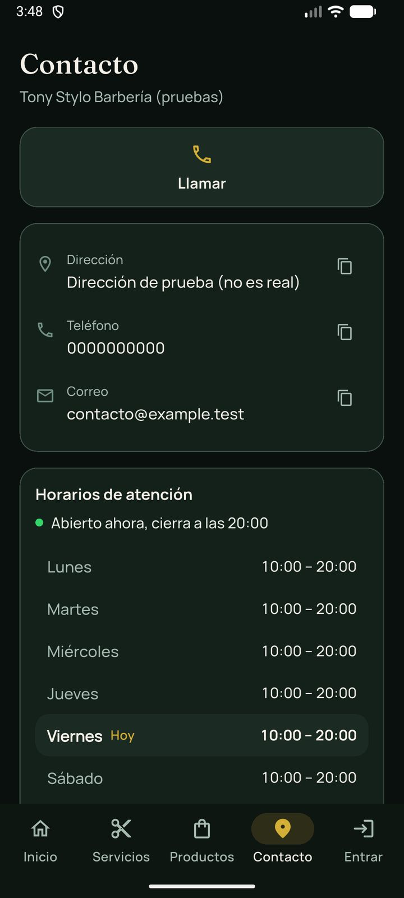 |

Para reservar necesitas una cuenta: **Reservar cita** o **Entrar** te llevan a iniciar sesión.

## 2. Crear tu cuenta

| Paso | Qué haces | Captura |
|---|---|---|
| 1. En **Inicia sesión**, toca **Regístrate**. | Se abre **Crea tu cuenta**. | |
| 2. Llena **Tus datos**. | Nombre(s), apellido paterno, apellido materno y teléfono (10 dígitos, sin espacios). | 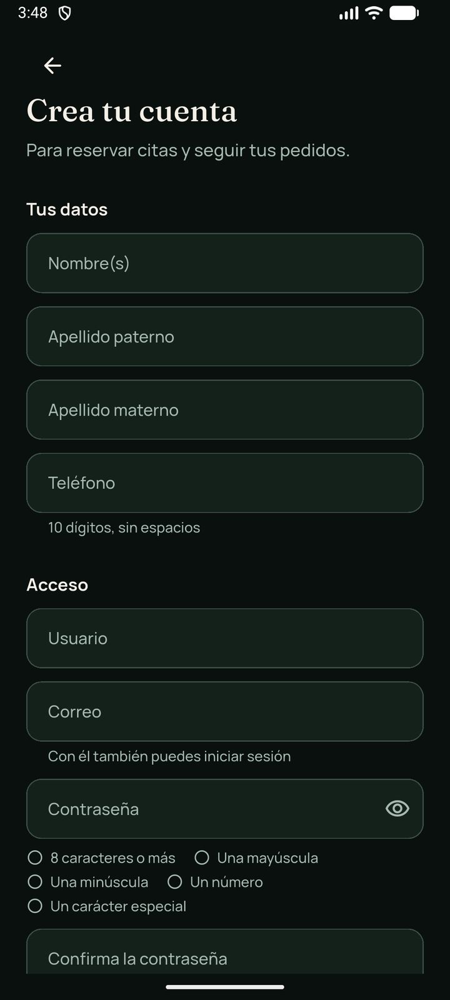 |
| 3. Llena **Acceso**. | Usuario, correo (con él también puedes iniciar sesión) y contraseña. La contraseña necesita 8 caracteres o más, una mayúscula, una minúscula, un número y un carácter especial; cada regla se marca al cumplirse. Confírmala. | 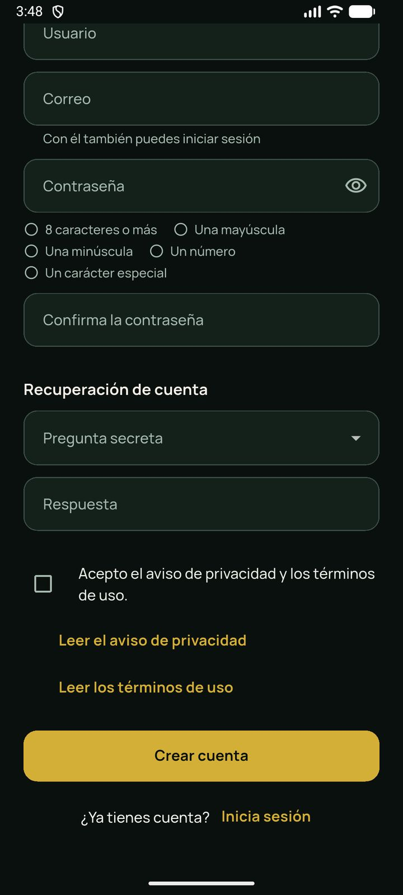 |
| 4. Llena **Recuperación de cuenta**. | Elige una pregunta secreta y escribe la respuesta. | (misma captura) |
| 5. Lee y acepta. | **Leer el aviso de privacidad** y **Leer los términos de uso** abren cada texto. Marca **Acepto el aviso de privacidad y los términos de uso**. | 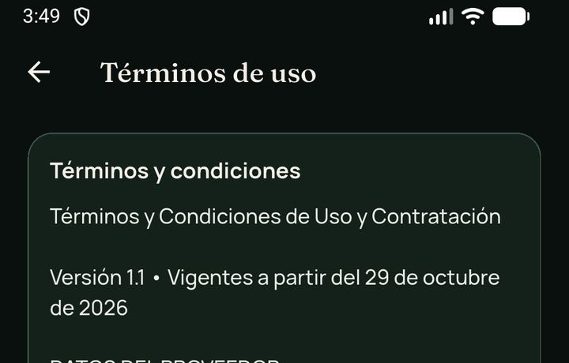 |
| 6. Toca **Crear cuenta**. | Desde la versión 0.8.1 el registro ya no pide un código por correo (PR #120). | Sin captura del resultado en esta serie. |

La captura de términos se recortó a propósito para no repetir los datos de contacto del responsable; el texto completo está en la app y en la web.

## 3. Iniciar sesión

| Paso | Qué haces | Captura |
|---|---|---|
| 1. Toca **Entrar** (barra inferior) o **Reservar cita**. | Pantalla **Inicia sesión**. También tienes **Volver al inicio** y **Aviso de privacidad**. | 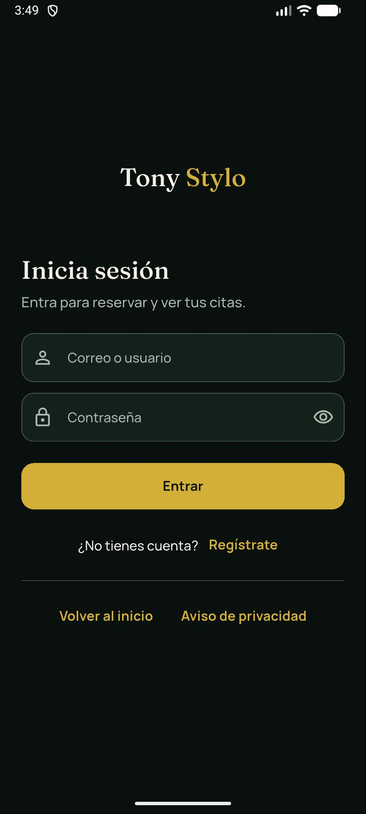 |
| 2. Escribe tu correo o usuario y tu contraseña. | El ojo muestra u oculta la contraseña. | 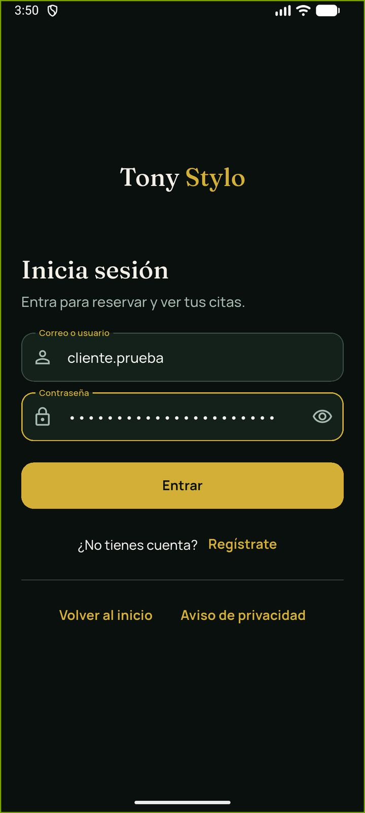 |
| 3. Toca **Entrar**. | Entras a tu inicio de cliente. Si activaste el código por correo, primero te lo pide (sección 11). | 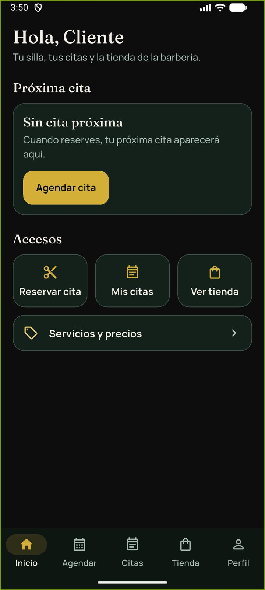 |

Si la contraseña no es correcta, la app se queda en esta pantalla y muestra el mensaje del servidor (caso PM01, evidencia `docs/evidencias/sprint-2026-10-20/capturas/02_pm01_login_invalido.png`, versión anterior).

## 4. Tu inicio

Con sesión iniciada, la barra inferior cambia a **Inicio, Agendar, Citas, Tienda y Perfil**.

- **Próxima cita**: si no tienes, ves "Sin cita próxima" y el botón **Agendar cita**. Si tienes, ves la fecha, la hora, el servicio, el barbero y **Ver detalle** (captura de la sección 13, `red_03`).
- **Accesos**: Reservar cita, Mis citas, Ver tienda y Servicios y precios.

## 5. Reservar una cita en 4 pasos

La barra de arriba muestra en qué paso vas. La flecha regresa al paso anterior.

| Paso | Qué haces | Captura |
|---|---|---|
| **1 de 4: Servicio.** Toca **Agendar** o **Reservar cita**. | Elige el servicio. Cada uno muestra precio y duración. | 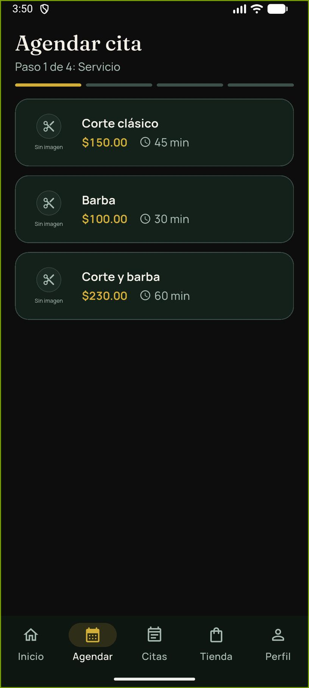 |
| **2 de 4: Barbero.** | Elige con quién. | 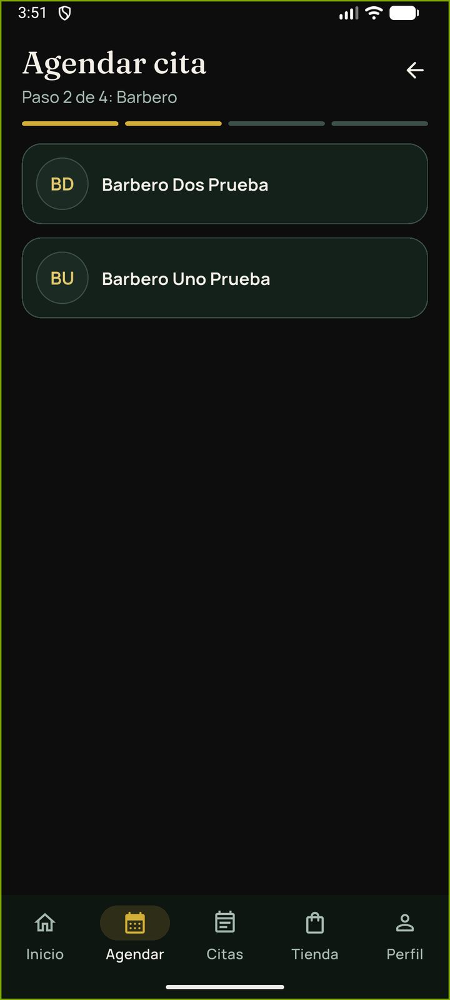 |
| **3 de 4: Fecha y hora.** | Elige el día en la tira de fechas. Abajo aparecen solo los **horarios libres** de ese barbero, que manda el servidor. | 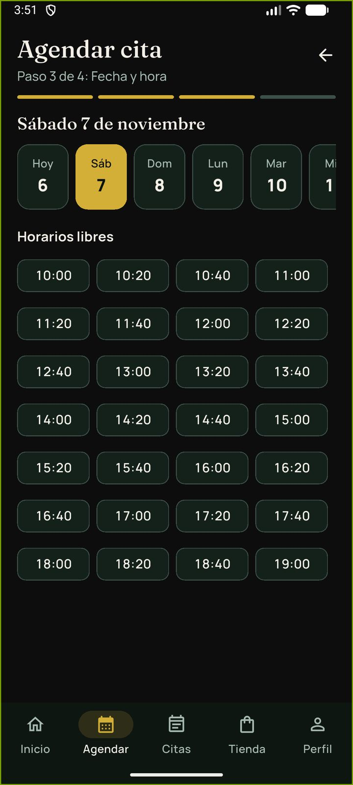 |
| | Toca la hora; queda marcada en dorado. Toca **Revisar y confirmar**. | 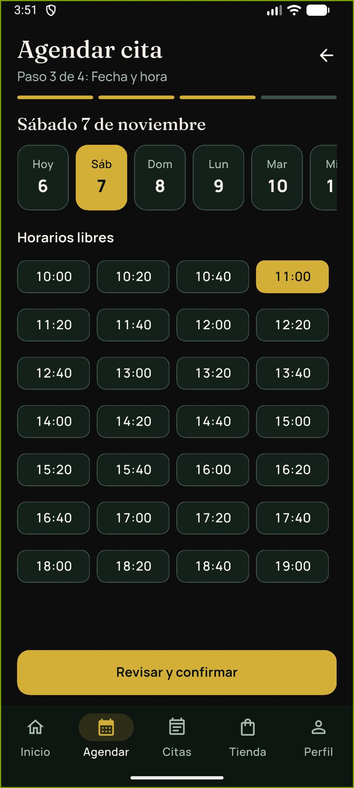 |
| **4 de 4: Resumen.** | Revisa día, hora, servicio, barbero, duración y total. Pagas en la barbería; si faltas sin avisar, tus siguientes citas pueden pedir un anticipo. Toca **Confirmar reserva**. | 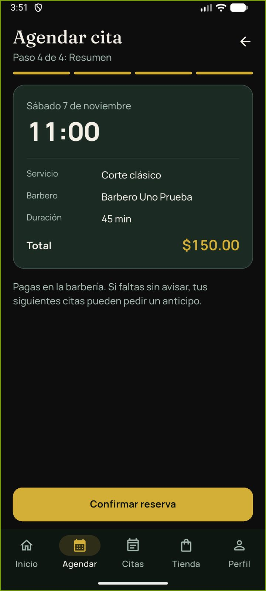 |
| Listo. | La cita aparece en **Mis citas** como **Confirmada**. | 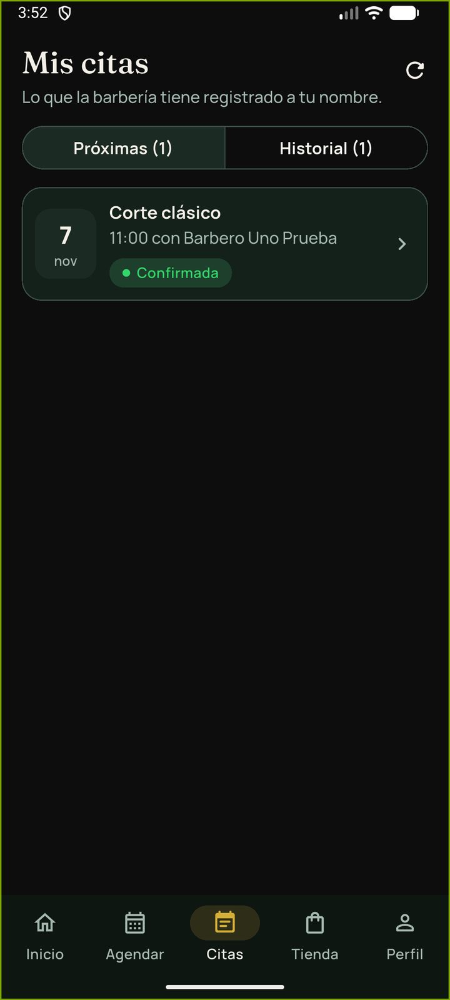 |

Si vuelves a agendar el mismo día con el mismo barbero, el horario que ya tomaste **ya no aparece** (en la captura falta 11:00):

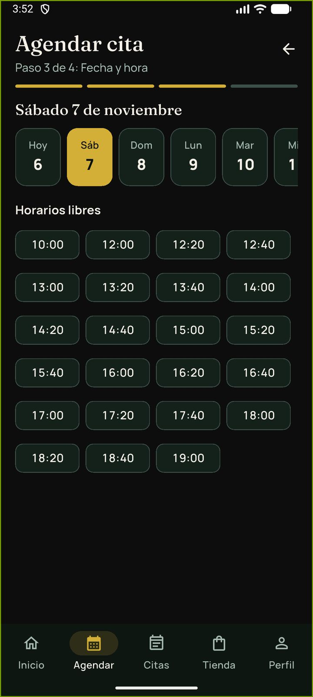

Toca el botón una sola vez: la app no envía la reserva dos veces aunque lo toques de nuevo mientras se envía (caso PM07).

## 6. Mis citas y detalle de una cita

| Paso | Qué ves | Captura |
|---|---|---|
| 1. Toca **Citas**. | Pestañas **Próximas** e **Historial**, con el número de citas de cada una. Cada cita muestra día, servicio, hora, barbero y estado. El botón de arriba a la derecha actualiza la lista. |  |
| 2. Toca una cita. | **Detalle de cita**: estado, día y hora, servicio, barbero, duración y el pago (total y lo que falta por pagar). | 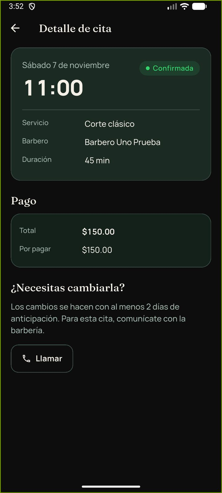 |
| Sin citas | "Aún no tienes citas" y el botón **Agendar cita**. Cada cliente solo ve sus propias citas (caso PM02): esta captura es la de otra cuenta de prueba, que no ve la cita del primer cliente. | 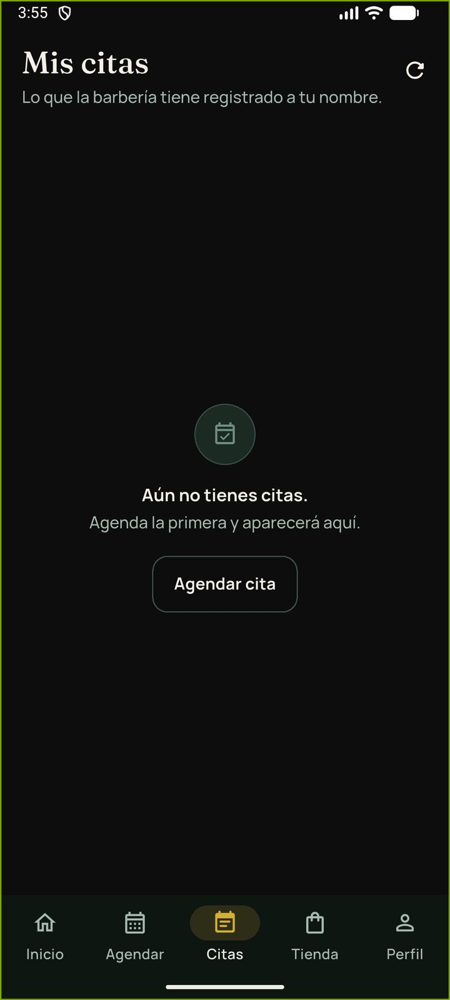 |

## 7. Reprogramar o cancelar tu cita

La sección **¿Necesitas cambiarla?** del detalle dice si puedes cambiar la cita tú mismo.

- **Plazo:** el cambio se hace con al menos **1 día** de anticipación, o **2 días** si la cita cae de viernes a domingo. Solo citas pendientes o confirmadas.
- **Dentro del plazo:** el detalle muestra **Reprogramar** y **Cancelar cita**.
  - **Reprogramar** abre los horarios libres del mismo barbero. Elige el nuevo día y la hora y confirma.
  - **Cancelar cita** pide confirmación y un motivo opcional. **Sí, cancelar** la cancela; **Conservar cita** no cambia nada. El horario queda libre para otra persona.
- **Fuera del plazo:** no aparecen esos botones. La app explica por qué y ofrece **Llamar** a la barbería. Es el caso de la captura: la cita es del sábado siguiente.

Si la cita tenía anticipo, la app no lo reembolsa: la barbería te dice qué sigue con ese pago.

**Sin captura en 0.8.1:** en esta serie no hubo una cita dentro del plazo, así que no hay captura de los botones Reprogramar y Cancelar. El recorrido completo se probó el 26-oct-2026 (develop `4622847`, emulador API 37) y sus capturas están en `docs/evidencias/cierre-funcional-2026-10-23/capturas/` (`03_con_plazo.png` a `08_cancelada.png`).

## 8. Tienda y pedidos

Pides en la app y recoges y pagas en la barbería.

| Paso | Qué haces | Captura |
|---|---|---|
| 1. Toca **Tienda**. | Productos con marca y precio, y **Agregar**. | 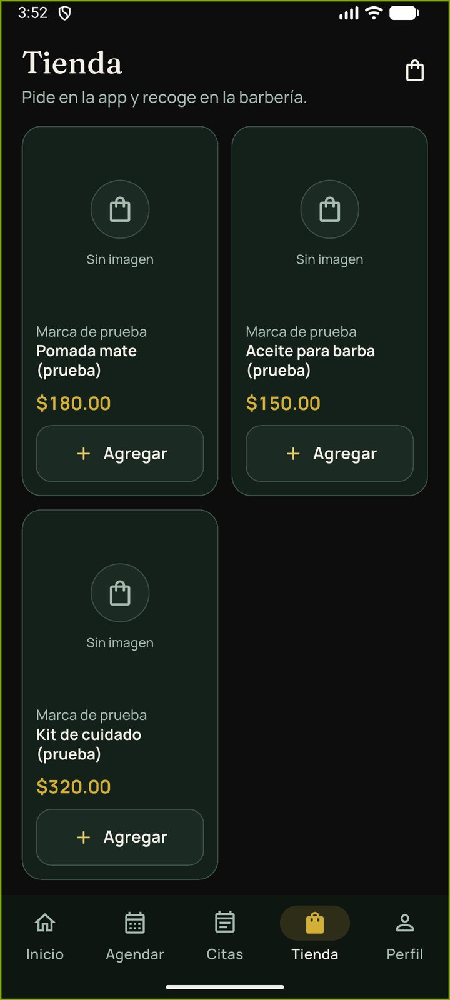 |
| 2. Agrega productos. | Cada producto agregado muestra **−/+** y el bote para quitarlo. Abajo aparece **Ver carrito** con el número de piezas y el total. | 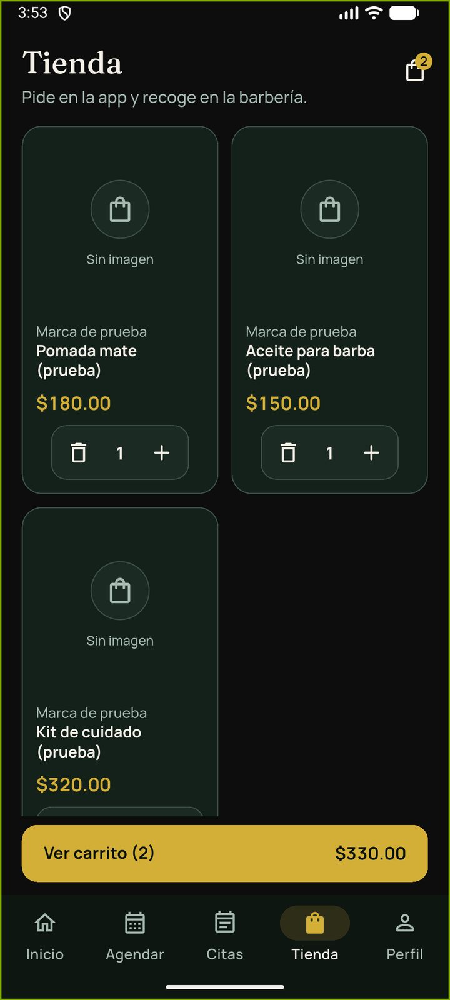 |
| 3. Toca **Ver carrito**. | Ajusta cantidades. Entrega: recoger en la barbería. Pago: en efectivo al recoger. El total es estimado: la barbería lo confirma al recibir el pedido. Puedes dejar una nota de hasta 200 caracteres. Toca **Hacer pedido**. | 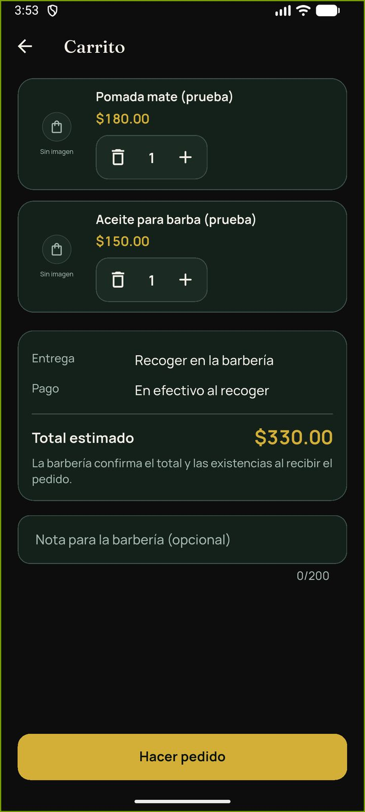 |
| 4. Pedido recibido. | Número de pedido y total. **Ver mis pedidos** abre la lista. | 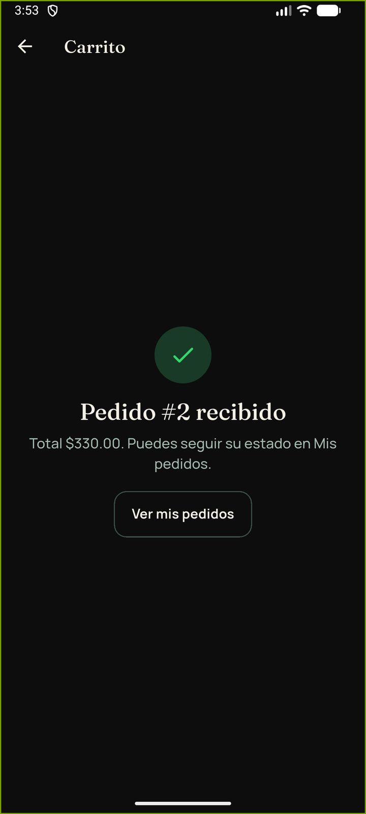 |
| 5. Mis pedidos. | Cada pedido con su estado (por ejemplo, **Pendiente**), fecha, productos, piezas y total. También está en **Perfil › Mis pedidos**. | 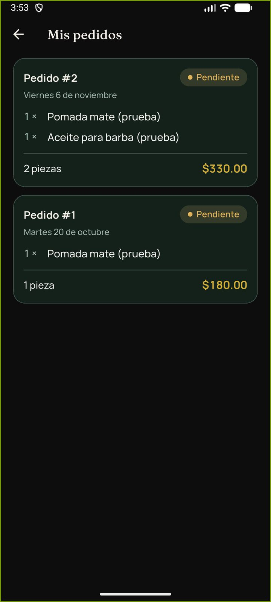 |

## 9. Perfil

Toca **Perfil**: tu nombre, correo, usuario y teléfono, y los accesos a **Mis pedidos**, **Privacidad y mis datos**, **Aviso de privacidad** y **Cerrar sesión**.

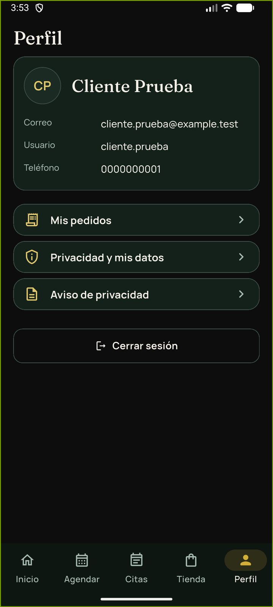

## 10. Privacidad y derechos ARCO

En **Perfil › Privacidad y mis datos** ejerces tus derechos sobre tus datos personales:

| Opción | Derecho | Qué hace |
|---|---|---|
| **Mis datos** | Acceso | Tu perfil y tu historial de citas. |
| **Corregir mis datos** | Rectificación | Cambia nombre, teléfono, fecha de nacimiento y dirección. |
| **Aviso de privacidad y preferencias** | Información y consentimiento | Qué datos se usan y para qué, y tus permisos opcionales. Los opcionales empiezan **apagados**. |
| **Oponerte a un uso de tus datos** | Oposición | Apaga las finalidades opcionales en "Aviso de privacidad y preferencias". Para otra solicitud, usa el medio que indica el aviso. |
| **Eliminar mi cuenta** (en rojo) | Cancelación | La cuenta se bloquea al momento y tus datos se borran en 30 días. Pide tu contraseña y escribir la palabra ELIMINAR; al terminar te da un folio y cierra la sesión. |

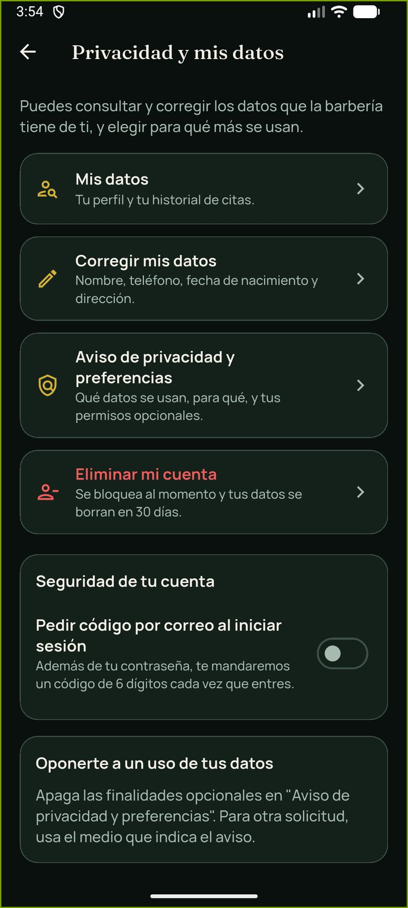

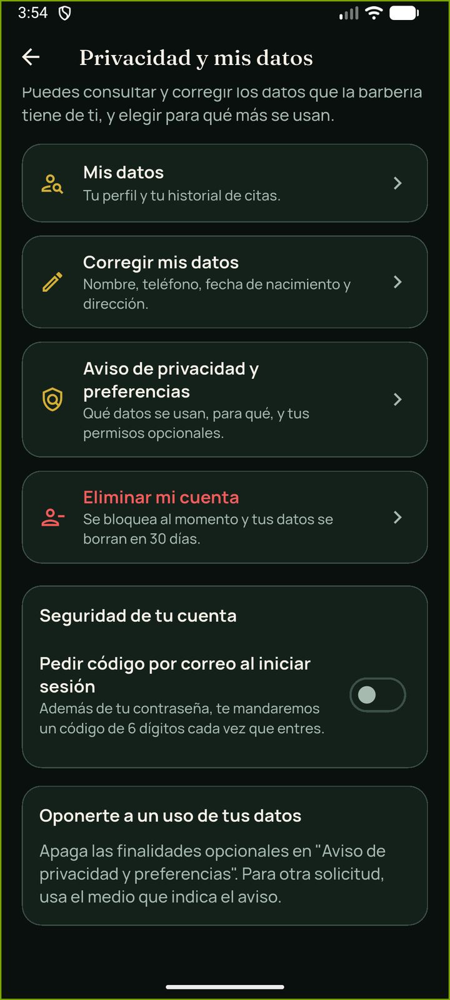

**Sin captura en 0.8.1** de las pantallas internas (Mis datos, Corregir, Aviso y preferencias, Eliminar mi cuenta). Las de versiones anteriores están en `docs/evidencias/sprint-2026-10-20/capturas/` (`07` a `11b`) y en `docs/evidencias/arco/2026-10-21-cancelacion/`.

## 11. Código por correo al iniciar sesión (2FA opcional)

Es opcional y empieza **apagado**. Está en **Privacidad y mis datos › Seguridad de tu cuenta**.

| Paso | Qué ves | Captura |
|---|---|---|
| Apagado (por defecto) | **Pedir código por correo al iniciar sesión** apagado. Entras solo con tu contraseña. |  |
| 1. Enciéndelo. | "Listo. Te pediremos un código al iniciar sesión." Desde ahora, además de tu contraseña, te mandamos un código de 6 dígitos cada vez que entres. | 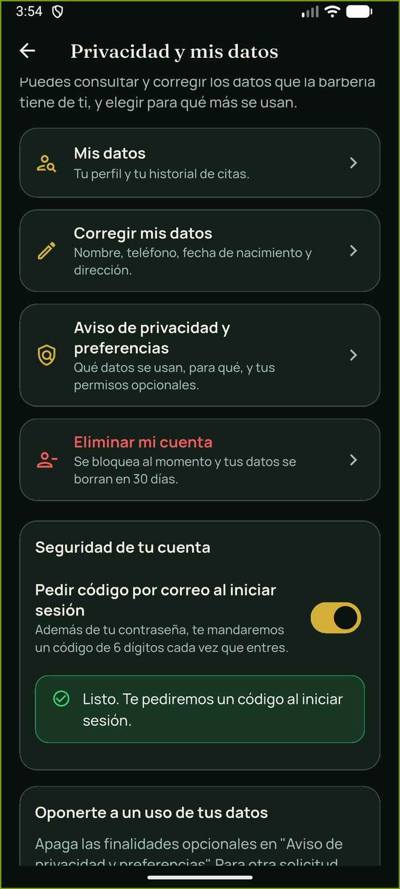 |
| 2. Para quitarlo, apágalo. | "Listo. Entrarás solo con tu contraseña." | 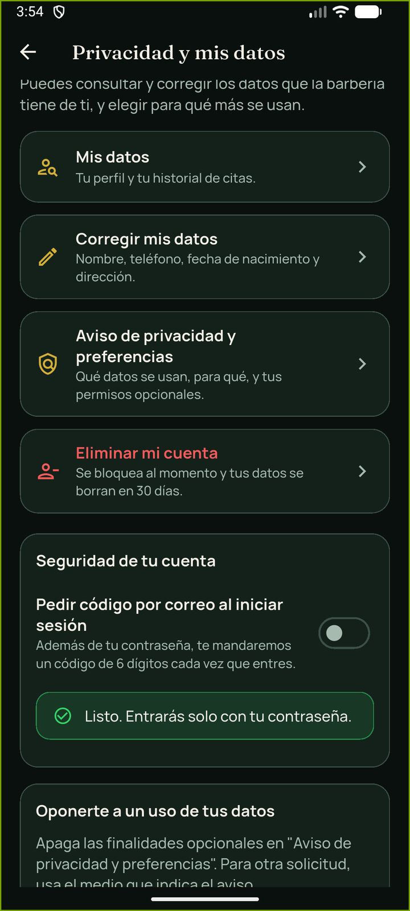 |

Con el código activo, después de **Entrar** la app pide el **código de 6 dígitos** que llegó a tu correo y ofrece **Reenviar código**. **Sin captura** de esa pantalla en esta serie: el backend local de pruebas no envía correos.

## 12. Cerrar sesión

En **Perfil**, toca **Cerrar sesión**. La app borra tu sesión del teléfono y vuelve al inicio de invitado. Si después entra otra persona en el mismo teléfono, no ve tus datos (caso PM09).

## 13. Sin conexión

| Situación | Qué ves | Captura |
|---|---|---|
| Sin internet (modo avión) | La pantalla de Servicios se ve con el modo avión activo. | 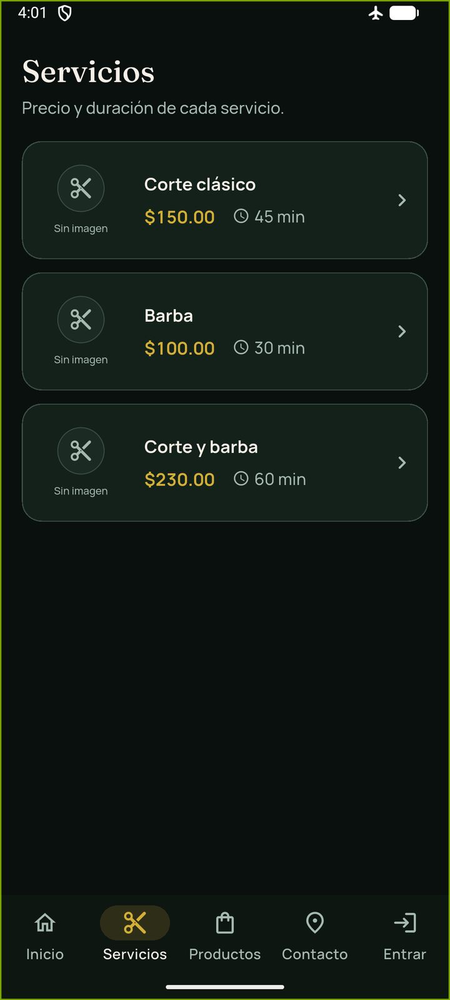 |
| Intentas entrar sin internet | "No hay conexión con el servidor. Revisa tu internet e intenta de nuevo." Tus datos escritos se conservan. | 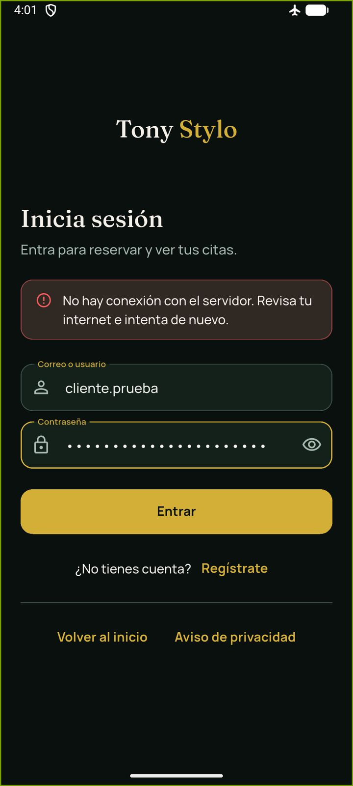 |
| Vuelve la conexión | Toca **Entrar** de nuevo y entras normalmente, con tu próxima cita. | 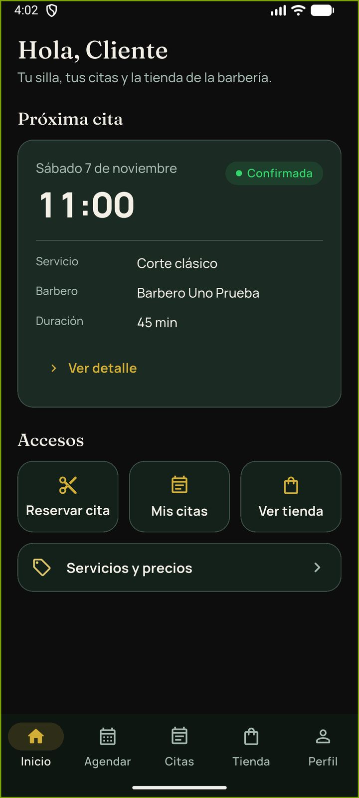 |

Un corte de red no cierra tu sesión ni muestra una reserva como hecha si el servidor no la confirmó (PR #103).

## 14. Texto grande

Si usas letra grande en Android, la app la respeta. Capturas con el texto del sistema al 130 %:

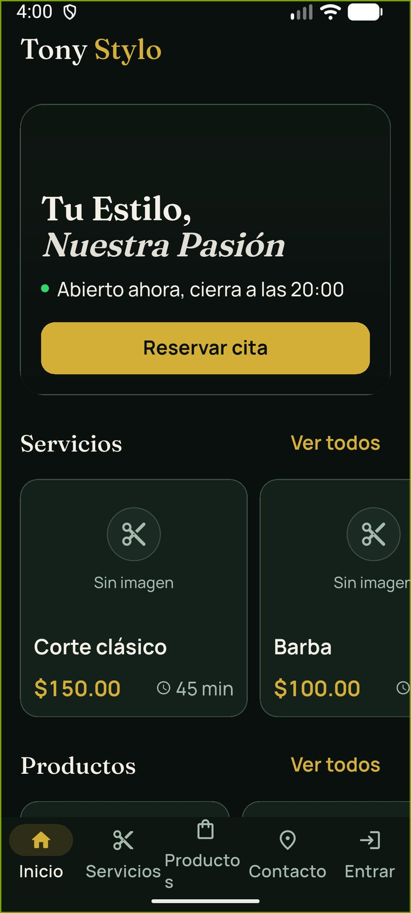

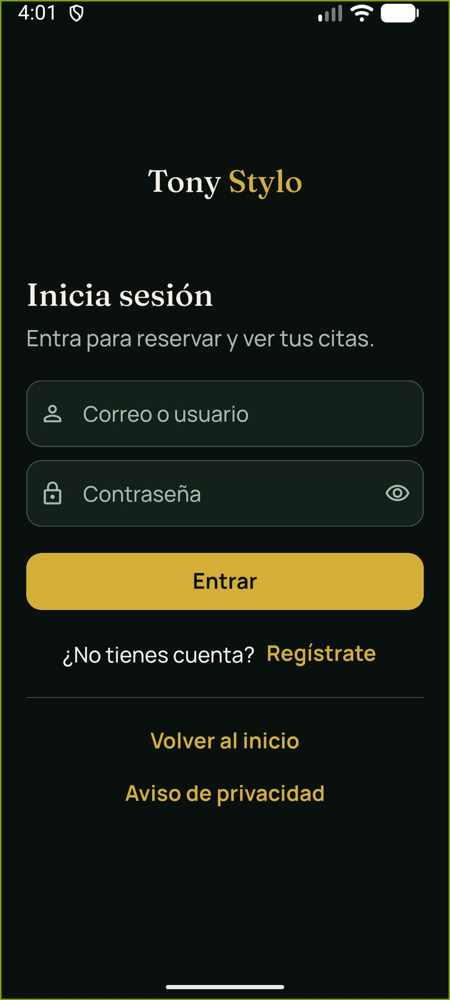

---

**Pantallas sin captura en esta versión:** resultado de crear la cuenta, pantalla del código 2FA, botones Reprogramar/Cancelar dentro del plazo y pantallas internas de Privacidad. Se describen con el texto real de la app y se indica la evidencia anterior.
