# Manual de uso: secretaría y barbero (Stylo Barber Connect)

Guía de la operación diaria en la app de **Tony Stylo Barbería** para la **secretaría** (recepción) y el **barbero**.

| Dato | Valor |
|---|---|
| Versión de la app en las capturas | **0.8.1+5** (la publicada en Google Play, prueba cerrada Alpha). Las capturas `fix_*` son de `develop` con la corrección del **PR #125** (BUG-01), que todavía no está en una versión publicada |
| Dispositivo | Emulador Android "Medium Phone", API 37 (Android 17), 1080 × 2400 |
| Servidor | Backend Django **local de pruebas** (no producción) |
| Fecha de las capturas | 6 de noviembre de 2026 |
| Tarjetas | DE-01, GH#63 (DOC-001) |

**Roles.** El alcance aprobado por el equipo (`docs/evaluacion/DECISION_ALCANCE_ROLES.md`, falta el visto bueno del docente) incluye en la app a Invitado, Cliente, **Secretaría** y **Barbero**. Administración, reportes, inventario, ventas, pagos y corte de caja se quedan en la web. El rol lo da el servidor: cada persona entra con el mismo formulario de **Inicia sesión** y la app la lleva a su panel.

Los nombres, teléfonos y correos que se ven son **datos de prueba** de la base local. Cuando un paso no tiene captura de esta serie, se dice y se indica la evidencia de una versión anterior.

## Contenido

**Secretaría**
1. [Hoy: la agenda del día](#1-hoy-la-agenda-del-día)
2. [Ver otro día](#2-ver-otro-día)
3. [Detalle de una cita](#3-detalle-de-una-cita)
4. [Cliente llegó, No asistió y Cobrar](#4-cliente-llegó-no-asistió-y-cobrar)
5. [Clientes y búsqueda](#5-clientes-y-búsqueda)
6. [Reprogramar una cita](#6-reprogramar-una-cita)
7. [Nueva cita y cliente de paso](#7-nueva-cita-y-cliente-de-paso)
8. [Más: qué está en la app y qué sigue en la web](#8-más-qué-está-en-la-app-y-qué-sigue-en-la-web)

**Barbero**

9. [Mi agenda de hoy](#9-mi-agenda-de-hoy)
10. [Pasó a la silla y Terminé el servicio](#10-pasó-a-la-silla-y-terminé-el-servicio)

---

# Secretaría

La barra inferior tiene **Hoy, Nueva, Clientes y Más**. Arriba a la derecha están **actualizar** (flecha circular) y **cerrar sesión**.

## 1. Hoy: la agenda del día

| Qué ves | Captura |
|---|---|
| Fecha y número de citas, y "En línea, actualizado a las…" para saber que los datos son recientes. Contadores **Por atender, En sala, Atendidas y No asistió**. Botones **Otro día** y **Nueva cita**, el buscador (cliente, servicio o barbero) y los filtros **Todas, Pendientes, Confirmadas, En sala…**. Si no hay citas: "No hay citas para esta fecha" y **Reintentar**. | 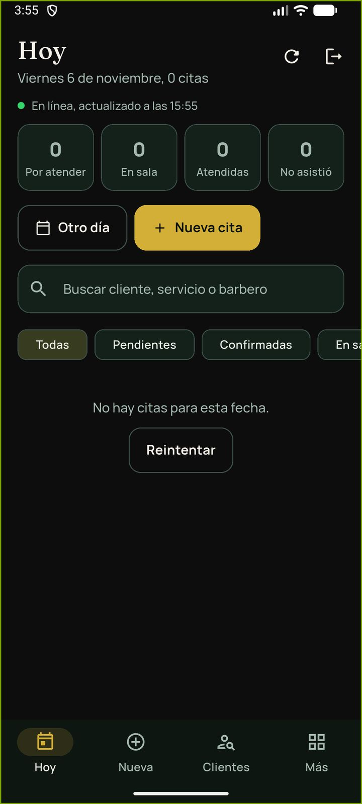 |

## 2. Ver otro día

| Paso | Qué haces | Captura |
|---|---|---|
| 1. Toca **Otro día**. | Se abre **Agenda de otro día** con el calendario. Elige el día y toca **ACEPTAR**. | 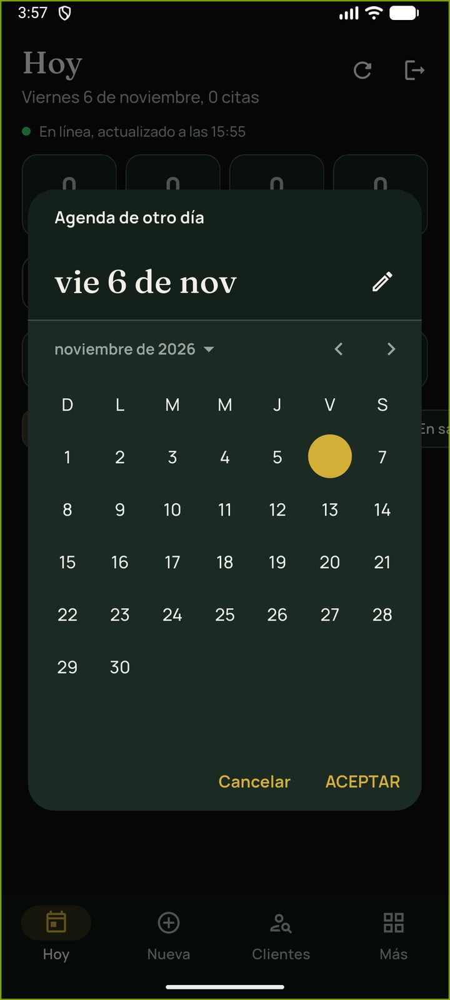 |
| 2. Revisa el día. | **Día seleccionado** con sus contadores y las citas. Cada fila muestra hora, cliente, servicio, barbero, estado y lo que falta cobrar ("Por cobrar $150.00"). **Volver a hoy** regresa a la agenda de hoy. | 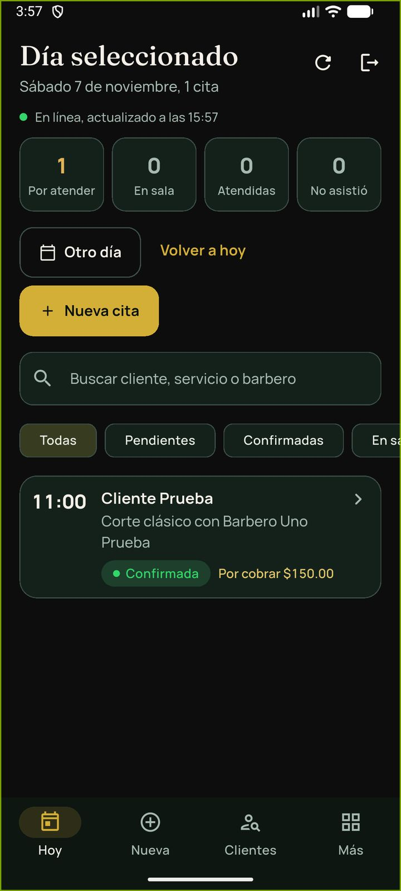 |

## 3. Detalle de una cita

Toca una cita para abrir **Cita #número**: hora, estado, día, cliente con su teléfono (el ícono de teléfono llama), servicio, barbero, duración, identificador y el pago (precio, anticipo pagado y restante). Abajo están las acciones: **Cliente llegó**, **Cobrar $…**, **No asistió** (en rojo), **Reprogramar** y **Volver a la agenda**.

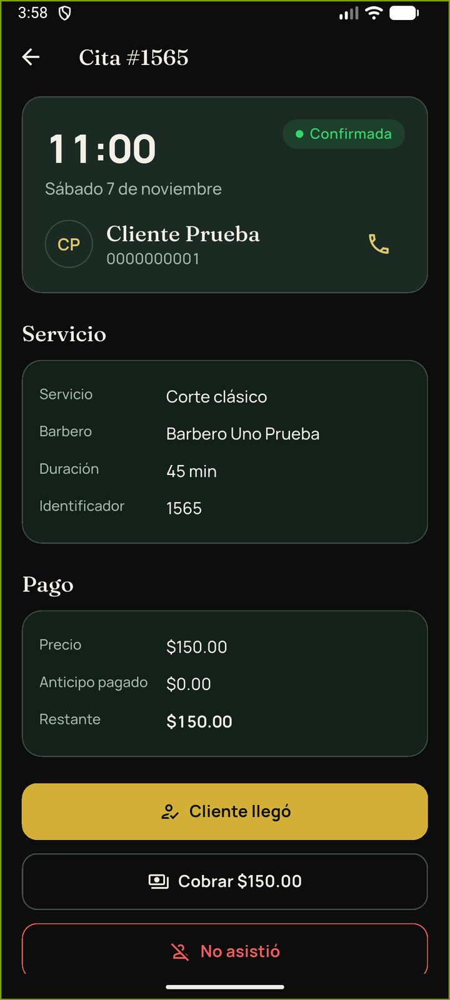

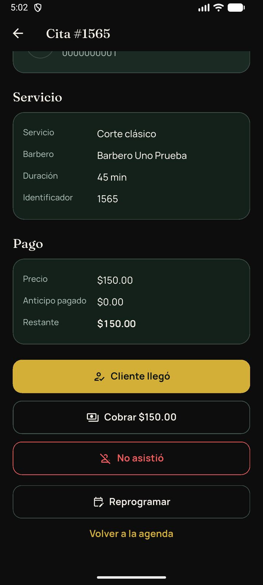

Las acciones que aparecen dependen del estado de la cita: el servidor dice cuáles se pueden hacer.

## 4. Cliente llegó, No asistió y Cobrar

| Acción | Qué hace | Cuidado |
|---|---|---|
| **Cliente llegó** | Marca que el cliente llegó a su cita. | — |
| **No asistió** | Marca la inasistencia. | **Penaliza al cliente:** sus siguientes citas pueden pedir un anticipo del 50 %. La app pide una confirmación fuerte que lo explica. Úsalo solo si de verdad no llegó. |
| **Cobrar $…** | Abre **Registrar cobro** con el monto restante. | La app no confirma pagos con tarjeta Clip: eso solo lo hace el servidor. |

Toca cada botón una sola vez: la app no repite la operación si se toca otra vez mientras se envía (caso PM07).

**Sin captura en 0.8.1** del resultado de estas tres acciones: la serie del 6-nov solo muestra los botones. Las capturas de la versión anterior (20-oct-2026, emulador Android 17 contra el backend local) están en `docs/evidencias/sprint-2026-10-20/capturas/`: `16_no_asistio_confirmacion_fuerte.png`, `17_secretaria_llego.png`, `18_secretaria_cobrar_dialogo.png` y `19_secretaria_cobrado.png`.

## 5. Clientes y búsqueda

| Paso | Qué haces | Captura |
|---|---|---|
| 1. Toca **Clientes** y escribe en **Buscar cliente**. | Aparecen los clientes que coinciden, con su teléfono. | 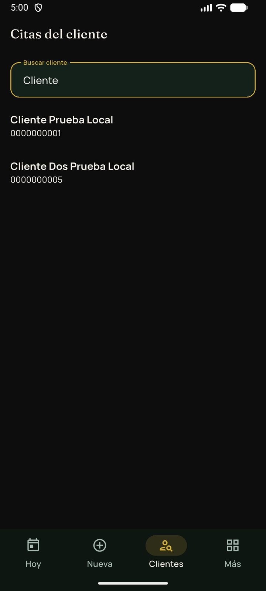 |
| 2. Toca un cliente. | Debajo aparecen sus próximas citas (fecha, hora, servicio, barbero y estado). | 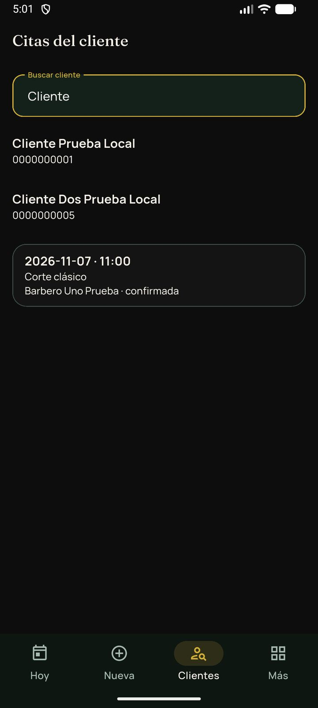 |
| 3. Toca una cita. | Se abre su detalle con las mismas acciones de la sección 3. | 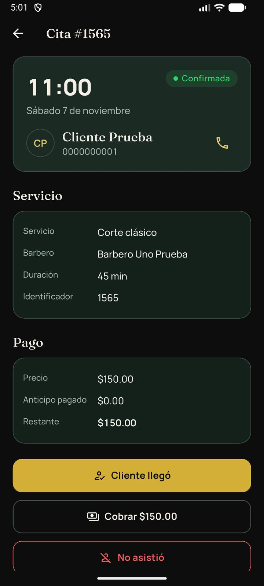 |

Antes de la corrección del PR #125, esta pantalla mostraba un error técnico de tipo y no listaba clientes (BUG-01, ERR-15 en `docs/evaluacion/REGISTRO_ERRORES.md`).

## 6. Reprogramar una cita

| Paso | Qué haces | Captura |
|---|---|---|
| 1. En el detalle, toca **Reprogramar**. | **Reprogramar #número** con el cliente, el servicio, el barbero, la fecha y los horarios. La hora actual aparece como "11:00 · actual". | 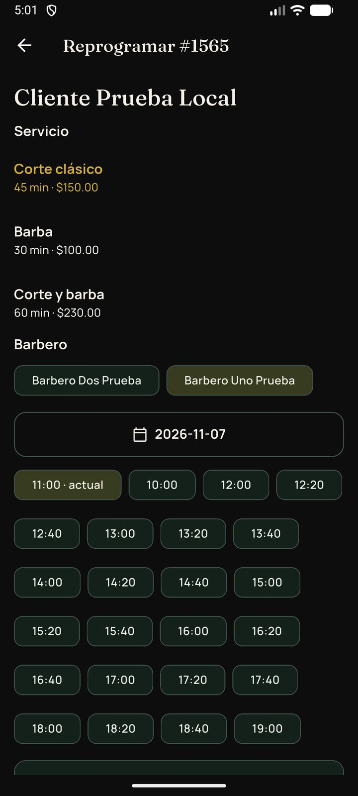 |
| 2. Elige el nuevo horario. | Puedes cambiar barbero o fecha. Toca la nueva hora (en la captura, 12:00). Puedes agregar **Notas**. Toca **Guardar cambio**. | 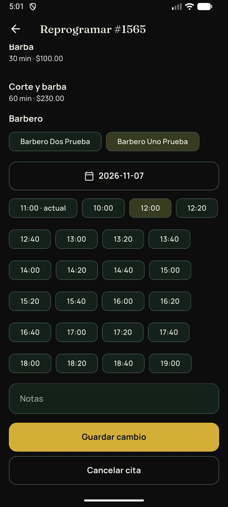 |
| 3. Confirma. | "El cambio se aplica solo cuando el servidor confirma el horario." Toca **Confirmar**. | 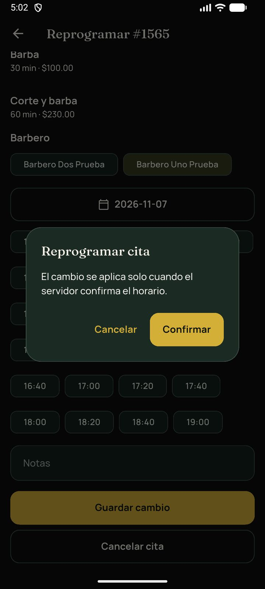 |
| 4. Listo. | Regresas al detalle de la cita. En la verificación del PR #125 la cita #1565 pasó de las 11:00 a las 12:00 y el servidor lo confirmó. |  |

En la misma pantalla está **Cancelar cita**; esta serie no la usó.

## 7. Nueva cita y cliente de paso

| Paso | Qué haces | Captura |
|---|---|---|
| 1. Toca **Nueva** (barra inferior) o **Nueva cita**. | Eliges cliente (con buscador), servicio, barbero, fecha y horario. Toca **Confirmar cita**. | 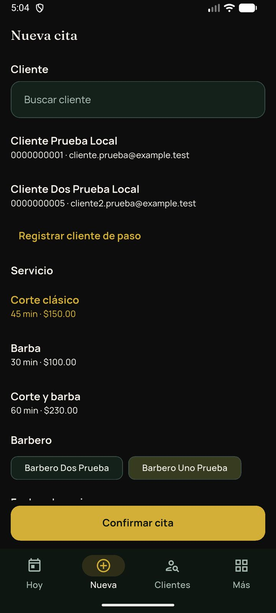 |
| 2. Si el cliente no tiene cuenta, toca **Registrar cliente de paso**. | Aparece un formulario corto: nombre, apellido paterno y teléfono. **Ocultar cliente de paso** lo cierra. | 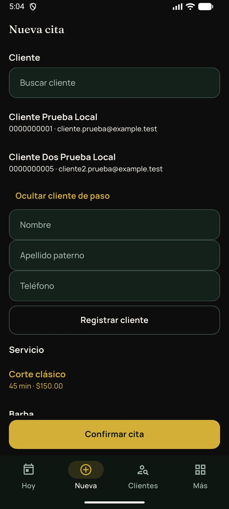 |
| 3. Llena los datos y toca **Registrar cliente**. | | 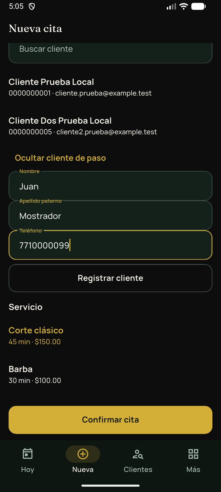 |
| 4. Confirma. | "Se creará un cliente en el servidor con el nombre y el teléfono indicados." Toca **Confirmar**. | 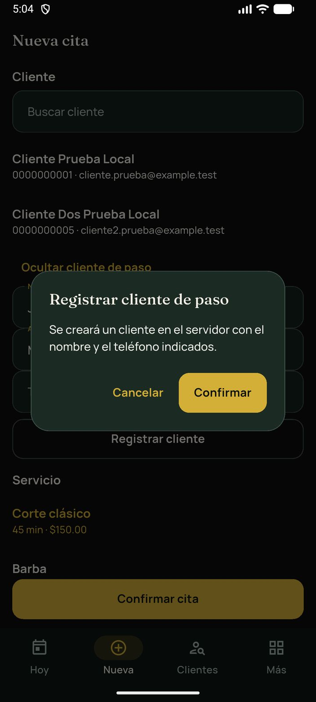 |
| Si el teléfono no es válido | "Teléfono inválido (10 a 15 dígitos)." Corrígelo y vuelve a intentar. | 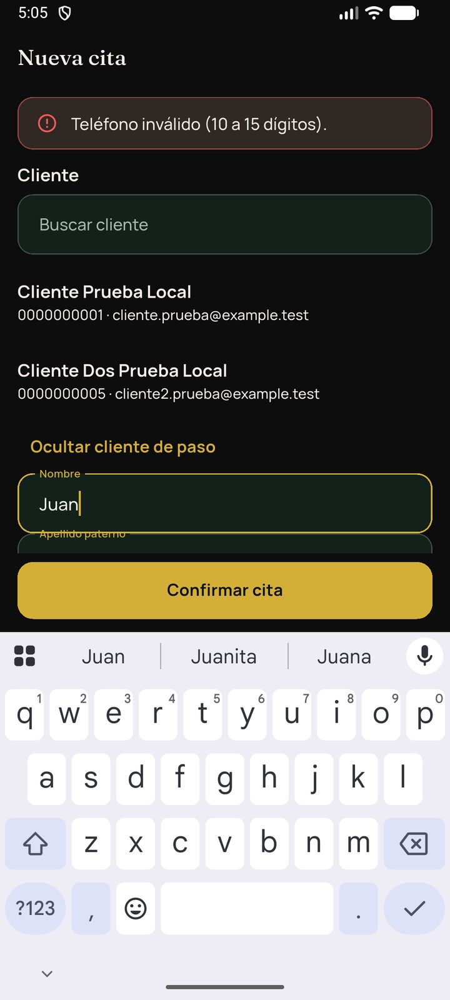 |

**Sin captura del alta terminada.** En la verificación del 6-nov la app ya enviaba el alta, pero el backend local respondía 500 por un problema del servidor (ERR-16). Se corrigió en el PR #11 del backend, fusionado en su `main` el 2026-11-06; con la app no se volvió a capturar el alta después de ese arreglo.

## 8. Más: qué está en la app y qué sigue en la web

**Más** resume lo que se puede hacer en la app (**Agenda del día, Nueva cita, Citas de un cliente**) y lo que **sigue en la web**: ventas (punto de venta), inventario, pedidos de mostrador y corte de caja.

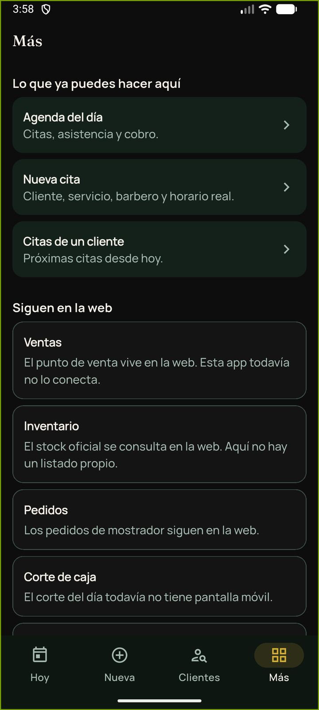

---

# Barbero

El barbero ve **solo sus citas**. Arriba a la derecha están **actualizar** y **cerrar sesión**.

## 9. Mi agenda de hoy

| Qué ves | Captura |
|---|---|
| **Mi agenda de hoy** con la fecha y el número de citas. Si no tiene: "Sin citas asignadas. Cuando la barbería te asigne citas, aparecerán aquí." | 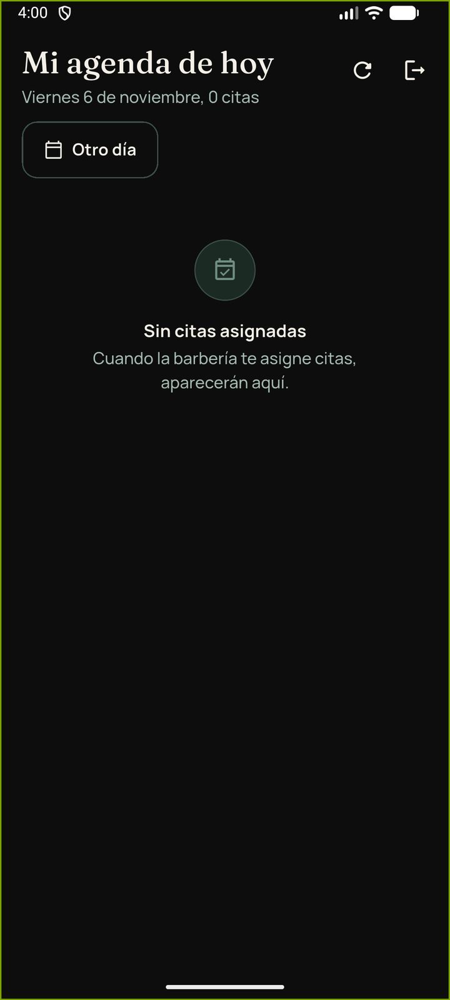 |
| **Otro día** consulta otra fecha. Aviso: "Puedes consultar otros días; la atención solo se marca en las citas de hoy." Cada cita muestra hora, duración, cliente, servicio y estado (**Por atender**). **Volver a hoy** regresa. | 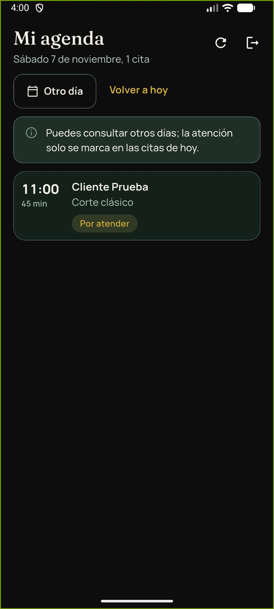 |

## 10. Pasó a la silla y Terminé el servicio

En una cita **de hoy**, el barbero tiene dos botones:

1. **Pasó a la silla**: el cliente empezó a ser atendido; la cita pasa a **en curso**.
2. **Terminé el servicio**: el servicio terminó. La cita queda lista para que la **secretaría cobre**.

Reglas que cuida el servidor: solo citas propias y de hoy; "terminar" sin haber iniciado se rechaza; el barbero **no** marca "No asistió" (eso es de la secretaría).

**Sin captura en 0.8.1:** el 6-nov el barbero de prueba no tenía citas de hoy (la única era del sábado 7), así que los botones no aparecían. El recorrido se probó el 26-oct-2026 (develop `4622847`, emulador API 37) y sus capturas están en `docs/evidencias/cierre-funcional-2026-10-23/capturas/` (`09_barbero_agenda.png`, `10_barbero_en_silla.png` y `11_barbero_terminado.png`).

---

**Pantallas sin captura en esta versión:** resultado de Cliente llegó, No asistió y Cobrar; alta terminada del cliente de paso; botones del barbero en una cita de hoy. Se describen con el texto real de la app y se indica la evidencia anterior.
